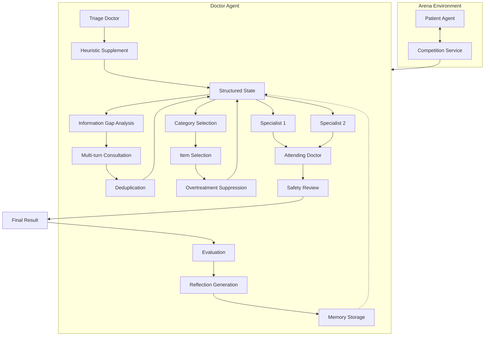
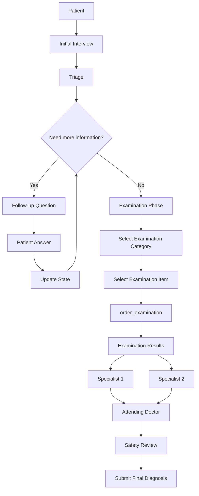
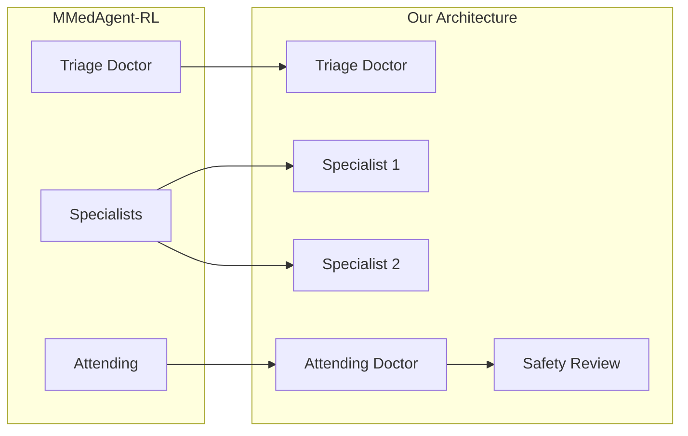
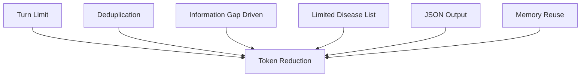
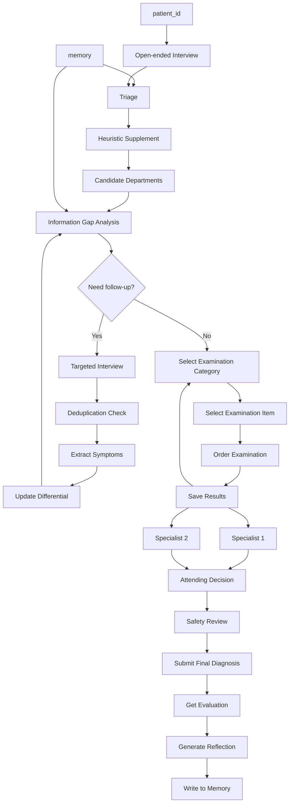
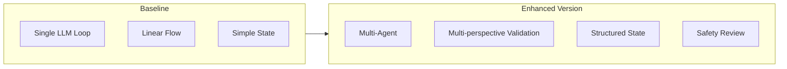

# YiXiao Hospital Agent: Real Multi-Agent Architecture

## Runtime implementation

The competition SDK still exposes a single entry point through `MyDoctorAgent`, but inside that entry point the `Orchestrator` schedules eight independent role instances. Disease Skills are specialized knowledge modules used by the Agents and are not counted as Agents.

```text
BasicAgent / MyDoctorAgent
            |
            v
      Orchestrator
   /       |        \
 triage  interview  differential
                         |
                    examination
                         |
             specialist(dept A/B) [parallel]
                         |
                     attending
                         |
                      safety --reject/retry--> attending
                         |
                       audit
                         |
                    SDK submission
```

Each handoff records source, target, task, status, risk level, Skill evidence, and validation results. Agents only return structured patches, which the Orchestrator merges into the central `CaseState` according to write permissions.

## 1. Overall Architecture Overview



## 2. Main Data Flow Loop



## 3. Paper Correspondence



## 4. Token Optimization



## 5. Complete Flowchart



## 6. Role Overview

| Role | Prompt | Responsibility |
|------|--------|------|
| Triage Doctor | TRIAGE_PROMPT | Determine department |
| Information Gap Analysis | INFO_GAP_PROMPT | Decide follow-up questions |
| Specialist 1 | SPECIALIST | General assessment |
| Specialist 2 | SPECIALIST | Differential diagnosis |
| Attending Doctor | ATTENDING | Comprehensive decision |
| Safety Review | SAFETY_REVIEW | Check contraindications |

## 7. Comparison


